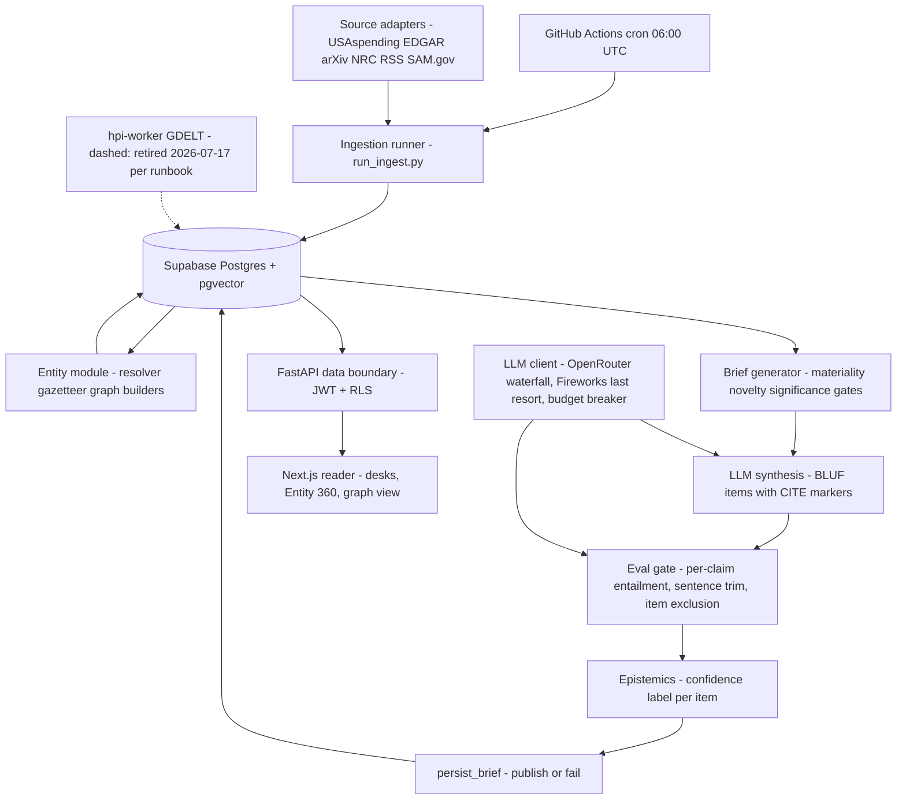
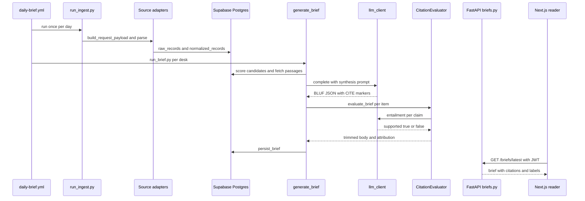

# Hard Power Intelligence — Master Explainer

Repo: <https://github.com/PCSchmidt/HardPowerIntelligence> · Live: https://hardpowerintel.com · API: https://hpi-api.fly.dev · License: PolyForm Noncommercial 1.0.0 (source-available; commercial use needs a separate licence) · Last commit: 2026-09-15 (`a5a91f6`)
Status: deployed production (live since 2026-06-12) · pre-revenue, payments built but off · build 2026-06-04 → 2026-07-27, docs refresh 2026-09-15
Explainer generated: 2026-10-18 by an AI agent under Chris Schmidt's direction · Questionnaire v1.1 · Depth: LITE (LITE run)

> Tags: **[Verified]** code/config/commits (path:line, function or SHA); **[Measured]** — none: this run performed no execution; **[Documented]** repo docs, reported as "the repo reports…"; **[Author]** confirmed `AUTHOR_CONTEXT.md` line; **[Inferred]** reasoned, basis stated; **[Proposed]** not in the repo; **[Unknown]** → §26. One fact, one home: discrepancies §24, risks §25, records §20.

## TL;DR

**V.1** HPI ingests the public record of defense, AI and energy (contract awards, SEC filings, regulatory actions, papers, news), resolves each company to a canonical entity, and publishes one cited BLUF brief per sector desk per day — every sentence checked by an entailment evaluator against its cited source before shipping, each item labelled confirmed / reported / HPI analysis / speculative. [Verified] `engine/engine/brief/publish.py`, `engine/engine/eval/citation_eval.py`, `engine/engine/brief/epistemics.py`

**V.2** For analysts who need "what changed yesterday and which companies does it touch" before markets open; the interesting part is the trust machinery: per-sentence citation stripping, an eval gate that withholds unprovable content, entity resolution held to a golden-set precision gate, a $3/run cost breaker, a cross-provider LLM fallback built after a real multi-day outage (D155–D159). Three caveats: the headline "faithfulness 1.000" is 1.0 by construction after claim trimming (`scripts/run_brief.py:76`); the entity-resolution cascade in the interview docs is largely unbuilt (`engine/engine/entity/resolution.py:11`); no CI job runs the test suite (`scripts/meridian-verify.sh`). See §20.

## Repository fact sheet

| Field | Value | Tag |
| --- | --- | --- |
| Name · packages | Hard Power Intelligence (HPI); `hpi-engine`, `hpi-api`, `hpi-worker` | [Verified] `pyproject.toml` |
| URL · visibility · license | github.com/PCSchmidt/HardPowerIntelligence · public · PolyForm Noncommercial 1.0.0 | [Verified]; visibility [Inferred] |
| One-line (from code) | ingest records → resolve entities → materiality/significance-gated BLUF synthesis per desk → per-sentence entailment trim → daily briefs via FastAPI + Next.js | [Verified] |
| Category · flags | AI application + data pipeline + subscription product · `[UI]` `[API]` `[DATA]` `[AI]` `[DEPLOY]`; no `[AGENT]`, not `[RESEARCH]` | [Inferred] |
| Status | production since 2026-06-12; multi-desk live data since 2026-06-14; pre-revenue; payments built, creds pending | [Documented] README |
| Languages / LOC | Python 138 files ~17.3k (engine 7.4k, tests 7.3k, scripts 5.7k, api 1.2k) · TS/TSX 87 files ~5.8k · SQL 20 files ~770 · shell 33 files ~5.4k · md 62 files ~15.7k | [Verified] `git ls-files` |
| Files · tests | 385 tracked; 63 Python test files / 718 `def test_` (parametrize adds cases), 15 web test files / 79 `it/test`; `tests/integration/` empty | [Verified]; repo reports 751 + 82 [Documented] |
| History | 196 commits on `main`, 2026-06-04 → 2026-09-15 (127 June, 68 July, 1 Sept); no tags; remote branch `copilot/source-grounded-markets-intelligence`; 83 commits carry Claude trailers (Opus 4.8 ×71, Sonnet 4.6 ×12) | [Verified] `git log` |
| Entry points | `scripts/run_ingest.py`, `scripts/run_brief.py`, `scripts/eval_resolver.py`, `scripts/seed_entities.py`, `uvicorn app.main:app --app-dir api`, `web: npm run dev`, `worker/tasks/app.py` (retired per runbook), `daily-brief.yml` | [Verified] |
| Clean clone / tests | not run (execution forbidden); README quickstart `uv sync --all-packages --extra dev` → `uv run pytest -m "not integration"`; repo reports 751 backend ~5.5 s offline + 82 web | [Documented]; results [Unknown] |
| CI | `daily-brief.yml` (06:00 UTC cron: ingest → per-desk brief matrix) + `meridian.yml` → `meridian-verify.sh` (gates/memory/evaluator/drift) — **no workflow runs pytest, vitest or `next build`**; last CI result [Unknown] | [Verified] |
| Live demo | hardpowerintel.com (reader + `/graph`); repo reports 200s + `health: ok` verified 2026-09-15 | [Documented] README |
| External services | Supabase (Postgres+pgvector, Auth, RLS); OpenRouter (DeepSeek V4 Flash/Pro, Qwen3.7 Max); Fireworks last resort; OpenAI embeddings; SAM.gov key; Lemon Squeezy (off); Vercel, Fly.io, GitHub Actions, Sentry, Resend, PostHog; free feeds: USAspending, EDGAR, arXiv, NRC/Federal Register, GDELT, RSS | [Verified] `.env.example` |
| AI coding tools evidenced | Claude Code (trailers; `.claude/` 14 skills, 10 hooks, 3 agent defs); Meridian harness vendored; GitHub Copilot (branch name); `.clinerules`/`.cursor`/`.windsurf` stubs | [Verified]; Codex/Gemini here [Unknown] |
| Related repos | Meridian framework (vendored; README calls HPI a Meridian dogfood); sibling intelligence apps per AUTHOR_CONTEXT ⚠ → [Inferred] | [Documented]/[Inferred] |
| Headline claims | 13 audited in §11 (CL-01…CL-13) | [Verified] |
| Scripts writing tracked files (not run) | `scripts/dump_sources.py` regenerates `docs/SOURCES.md`; ingest/brief scripts write the DB | [Verified] grep |
| Tests needing external resources | none found (respx-mocked HTTP; no markers) | [Verified] |

---

## 1. For everyone: what it does and why it matters (A)

**A.1 ★** Every morning it reads the public record of three sectors and writes each a short briefing: what changed, which companies it touches, where each fact came from. [Verified] `engine/engine/brief/`

**A.2 ★** Analysts can find this data themselves, but it is fragmented, slow to read, and unsourced summary is untrustworthy. Before: manual reading, aggregators, expensive terminals. HPI's difference is connective — an award to "Lockheed Martin Rotary and Mission Systems" resolves to `LMT`, its segment and second-order beneficiaries, with each item labelled confirmed / reported / analysis / speculative. [Documented] README "Motivation"; [Verified] `epistemics.py`

**A.5 ★ Analogy.** A newsroom with a strict standards editor: reporters (adapters) file raw copy; the copy desk (entity resolver) identifies the company; the section editor (materiality + significance gates) chooses what is worth covering; the writer (LLM) drafts; the fact-checker (entailment evaluator) cuts every sentence it cannot prove; the editor stamps each item with how solid it is. [Inferred] from `engine/`.

**A.10 ★ Can't do.** Verify anything outside its cited passages; its analysis layer is interpretation checked only for fabricated specifics; AI/Energy desks are shallower than Defense (repo-disclosed); no personalization, advice or on-demand regeneration; GDELT news ingestion was parked when the Fly worker was retired (per runbook — README disputes this, §24 D.2). Use it as a well-sourced morning scan, not an investment-grade record. [Documented] README "Limitations"; [Verified] `DEPLOY_RUNBOOK.md` §2.5

**A.13–A.14** ~7 weeks part-time (June–July 2026), Chris Schmidt directing Claude Code, alongside his full-time role as a Machine Learning engineer — 5.5 years' experience [Author] 2026-10-18, confirming the "ML Engineer" framing of [Documented] `EXPLAINER.md`, `TALKING_POINTS.md`; commit cadence corroborates [Verified]. A non-programmer could not have handled the RLS/JWT/paywall and live-outage diagnosis; the human contribution is the D001–D159 decision trail [Inferred].

Improvement records: none for Part A.

---

## 2. Purpose, problem, users and use cases (B)

**B.1 ★ Problem.** Public data moving defense/AI/energy markets is fragmented across agencies and formats; connecting a raw event to the security it affects takes analyst hours every morning. [Documented] README. Motivation: the author works in the defense sector and these topics are "relevant and of interest" to him [Author] 2026-10-18 (Q6) — this confirms the ⚠-derived intelligence/analysis-apps grouping in AUTHOR_CONTEXT rather than replacing it.

**B.11 ★ Users.** Primary: a defense/energy investor or analyst reading before market prep [Documented] D014. Secondary: researchers using `/graph` and Entity 360. Poorly served: anyone wanting advice, personalization, alerts or non-English coverage. No real users evidenced — pre-subscriber.

**B.12 ★ Use stories** (state in §3): analyst reads a cited daily BLUF brief per sector (**working**); analyst clicks a company to Entity 360 + cross-desk connections (**working**); reader sees each item's confidence basis (**working**); operator is paged on silent pipeline failure (**working**, D156); subscriber pays for archive access (**built, not enabled**).

**B.18 ★ Out of scope (deliberate).** Per-user generation, buy/sell advice, portfolios, brokerage — to keep marginal reader cost near zero and a "publisher not advisor" posture [Documented] `EXPLAINER.md`, `docs/SCOPE.md`; the cross-desk convergence brief is planned, not shipped.

**B.19 ★ Success measures.** Measured in-repo: per-brief faithfulness, resolver golden-set precision/recall, test counts [Verified] `EVAL_BASELINE.md`, `tests/fixtures/entity_golden.json`. Asserted, unmeasured: $/brief, latency, uptime, subscribers.

Improvement records: W-SCOPE-1; Low: W-SCOPE-2.

---

## 3. Capabilities inventory (B.12, J.1)

| Capability | State | Evidence |
| --- | --- | --- |
| 7 source adapters over one ingestion contract; fetcher, cursors, dedup, accounting, circuit breaker | implemented | [Verified] `adapters/registry.py`, `ingest/` |
| Entity resolution: exact identifier → pg_trgm precision-first match → mint from CIK/UEI; gazetteer linking | implemented | [Verified] `resolution.py`, `linker.py` |
| LLM disambiguation tiers, OpenFIGI/GLEIF crosswalk, pgvector candidates | in interview docs, **not built** | [Verified] `resolution.py:11`; §24 D.4 |
| Materiality + novelty + significance gates; primary-desk routing; convergence boost | implemented | [Verified] `materiality.py`, `significance.py` |
| RAG-grounded BLUF synthesis with `[CITE:N]`, temperature 0 | implemented | [Verified] `generator.py`, `prompt.py`, `rag.py` |
| Citation stripping; per-claim entailment; item exclusion; analysis grounding | implemented | [Verified] `citation_eval.py:106`, `publish.py` |
| Confidence labels; publish on ≥1 honest item + regenerate-then-best-attempt | implemented | [Verified] `epistemics.py`, `publish.py:103` |
| LLM waterfall, 402 refill wait, two-phase Fireworks last resort, $3/run breaker | implemented, outage-tested | [Verified] `client.py:274-281`; D155–D159 |
| `CONVERGES_WITH`/`AWARDED` edges; `/graph` UI, hand-rolled force layout | implemented | [Verified] `graph_builder.py`, `web/lib/graph-layout.ts` |
| FastAPI JWT boundary, RLS lockdown, Lemon Squeezy webhooks; D013 staleness fallback | implemented; payments **off** | [Verified] migrations, `api/` |
| GDELT always-on worker | code present; production state contradictory | §24 D.2 |
| Convergence brief; dedicated AI/Energy sources; on-demand regeneration | planned | [Documented] README, `docs/SCOPE.md` |


---

## 4. Domain perspective (C)

**C.1 ★** Domain: OSINT for defense/AI/energy markets. Concepts: desk, record, entity + identifiers (ticker/CIK/UEI), item types (award/filing/policy/macro/signal/operational/research, `generator.py:74`), BLUF structure, cited fact vs analysis (`read`/`watch`/`convergence_read`), and an estimative confidence ladder deliberately mirroring intelligence practice (`epistemics.py` docstring). The ladder collapses the IC's two-axis probability×confidence model to one axis — fine for investors, non-standard to an IC analyst. [Verified]; [Inferred] on IC norms.

**C.2 Standards.** Followed: BLUF format, SEC `company_tickers.json` as authoritative ID map, HTTP/JSON norms. Ignored: MIL-STD-2525, NATO report formats, Cursor-on-Target, formal estimative lexicons, source-reliability grading (`source_reliability`/`license_class` documented follow-ups, unbuilt, `adapters/feeds.py`). Defensible for investors; not for a government customer. [Verified]; [Inferred].

**C.6–C.9 Data sources.** Seven free/public adapters (USAspending, EDGAR full-text, arXiv, NRC via Federal Register, RSS, SAM.gov with key, GDELT DOC 2.0). Provenance by construction: URL + fetch timestamp + content hash per raw record; `[CITE:N]` → passage index [Verified]. Licensing posture in `docs/DATA_SOURCES.md` [Documented]. Stale data surfaced via the D013 indicator.

**C.15 ★ Trust for a real decision.** As a morning scan, once three gaps close: a populated faithfulness track record (4 recorded runs, all early), AI/Energy depth parity, legal review of the "not investment advice" posture (repo says "get real review"). Residual harm path: "HPI analysis" items read more authoritative than their hedge. [Documented]/[Inferred].

Improvement records: Low rows (W-DOM-1/2).

---

## 5. Codebase guide (D)

**D.1 ★ Tree** (★ = core):

```
engine/★            hpi-engine pipeline
  adapters/★        7 source adapters + registry (build_request_payload / parse / next_cursor)
  ingest/★          fetcher, runner (cursors, dedup, accounting), retention
  entity/★          reference set, gazetteer, resolver, linker, graph + funding builders
  brief/★           materiality, significance, prompt, rag, generator, analysis, epistemics
  eval/★            citation_eval — the entailment gate
  llm/★             client — waterfall, fallback chain, budget breaker
  ops/              health, notify, provider_balance; signal/ GDELT momentum
api/★               FastAPI data boundary (auth, briefs, entities, graph, calendar, webhooks, health)
web/★               Next.js 16 reader (desks, Entity 360, /graph, auth, subscription)
worker/             retired GDELT worker — kept for history
supabase/migrations/★ 20 migrations (schema, RLS, HNSW, taxonomy fixes)
scripts/            run_ingest, run_brief, eval_resolver, seed_entities, health/cost reports, Meridian scripts
tests/★             unit + api + fixtures; integration/ empty
.claude/ .meridian/ .clinerules/ .cursor/ .windsurf/   agent tooling + gate governance
docs/               PHILOSOPHY, ARCHITECTURE, SCOPE, DATA_SOURCES, CONVERGENCE_GRAPH_PLAN, PAYMENTS_GOLIVE_PLAN
root *.md           SPEC, CONTRACT, API_SPEC, DATABASE_SCHEMA, DECISIONS (D001–D159), EVAL_BASELINE, SECURITY_AUDIT, EXPLAINER, TALKING_POINTS
```

**D.2 ★ Entry points.** `run_ingest.py` (fetch → parse → persist → embed), `run_brief.py --desk <d>` (generate → eval → publish; exit 0/3/1 = published / thin skip / hard failure), `uvicorn app.main:app`, `npm run dev`, scheduled `daily-brief.yml`. [Verified]

**D.3 ★ Setup.** Python 3.12+, uv, Node, Supabase project, keys per `.env.example` (`SUPABASE_*`, `DATABASE_URL`, `OPENROUTER_API_KEY`, `OPENAI_API_KEY`, `SAM_GOV_API_KEY`, optional `FIREWORKS_API_KEY`, Lemon Squeezy vars). Commands: `uv sync --all-packages --extra dev`; `uv run pytest -m "not integration"`; `cd web && npm install && npm run dev`. Not executed → [Documented].

**D.7 ★ Key files.** `eval/citation_eval.py` (sentence split, D139 repair, `strip_uncited_sentences`, `CitationEvaluator.eval_item/eval_analysis`); `brief/publish.py` (`evaluate_brief`, `generate_publishable_brief`); `brief/generator.py` (863 lines: scoring, gates, synthesis, `persist_brief`); `llm/client.py`; `entity/resolution.py`+`linker.py`; `ingest/runner.py`; `routers/briefs.py`; `scripts/run_brief.py`; `DECISIONS.md`.

**D.8 ★ Function that captures the purpose.** `CitationEvaluator.eval_item` (`citation_eval.py:138`): splits an item body into claims, auto-fails uncited claims, asks the judge per claim whether the cited passage supports it, and returns **only individually supported sentences** — the product promise enforced mechanically. `evaluate_brief` turns those verdicts into publish + labels.

**D.11–D.13** Clean separation: adapters' `parse` and `brief/` scoring are pure; I/O confined to `runner.py`, `client.py`, `db`. Errors: structlog, per-desk exit codes, `transient_retry`, terminal (401/402/403) vs retryable provider errors. Model text is regex-parsed (`_CITE_RE`, `_CITE_KEYWORD_RE`) — D139's repair exists because that drifts. [Verified]

**D.17 ★ README accuracy.** Accurate on architecture/deployment; wrong on eval-gate semantics, worker status, CI. **8 discrepancies** (§24); most important: a publish-blocking faithfulness threshold the code retired in D099. GitHub description/topics: [Unknown].

Improvement records: Low rows (W-CODE-1/2).

---

## 6. Tech stack and rationale (E)

| Layer | Technology | Why (tag) | Trade-off accepted |
| --- | --- | --- | --- |
| Languages | Python 3.12 engine/api; TypeScript web | AI/data ecosystem + modern reader [Verified] D025/D020 | Go/Rust throughput unneeded (LLM-bound) |
| API | FastAPI + asyncpg + Pydantic v2 | typed, async [Verified] D009/D011 | more boilerplate |
| DB | Supabase Postgres + pgvector + Auth + RLS | one vendor [Verified] D005 | lock-in; RLS complexity |
| LLM | LiteLLM → OpenRouter (DeepSeek V4 Flash/Pro, Qwen3.7 Max); Fireworks last resort | role-pinned models, billing independence [Verified] D006/D155 | indirection; LiteLLM fallback bug (D158) |
| Embeddings | OpenAI text-embedding-3-small | [Verified] D026 | vs open-weight |
| Frontend | Next.js 16 / React 19 / Tailwind v4 / TanStack Query | SSR suits a reading product [Verified] D020 | — |
| Payments | Lemon Squeezy (over Stripe) | VAT offload for solo operator [Documented] `EXPLAINER.md` | processor lock-in |
| Jobs | GitHub Actions cron; queue/worker retired | lowest ops solo [Verified] | no on-demand runs |
| Tests | pytest + respx + cov; Vitest + Testing Library | offline suites [Verified] | — |
| Deploy | Vercel, Fly.io (`fly.api.toml`, two Fly accounts), Supabase | [Verified] `DEPLOY_RUNBOOK.md` | manual deploys |
| AI coding tools | Claude Code + Meridian + Copilot branch + Cline/Cursor/Windsurf stubs | [Verified] configs, trailers | — |

**E.1 ★** Python where the LLM/data ecosystem is; TypeScript for the reader. **E.3 ★ Load-bearing:** `litellm` (its fallback bug forced a hand-rolled walker), `asyncpg`, `pydantic-settings`, `openai`, `httpx`; `tenacity` declared while retries are hand-rolled [Verified]. `uv.lock` committed (D052). **E.5b ★ Drift:** not re-resolved (execution forbidden); results record model IDs but not package versions → lockfile is the only drift anchor.

Improvement records: Low (W-STACK-1).

---

## 7. Architecture (F)

**F.1–F.2 ★** Pipeline/batch wrapped in client–server: scheduled ingestion → Postgres as source of truth → scheduled synthesis/eval → stateless FastAPI read boundary → Next.js reader. Components: adapters, ingestion runner, Supabase+pgvector, entity module, candidate gates, RAG+synthesis, eval gate + epistemics, LLM client, API boundary, web reader, ops/alerts. "Store what is expensive, recompute what is cheap": one shared brief per desk makes reader marginal cost ~zero (D003). [Verified]



**F.3 ★ End-to-end trace (one daily run).** (1) `daily-brief.yml` `ingest` runs `run_ingest.py` → `runner.py` advances cursors, `fetcher.py` retries, adapters' `parse` fills `raw_records` (hashed) + `normalized_records`, chunks embedded. (2) `brief` runs `run_brief.py --desk <d>` per desk concurrently (D113) → `publish.generate_publishable_brief` loops `generator.generate_brief`: `_score_candidates` (`generator.py:163`) applies `MaterialityScorer.score` (`materiality.py:61`), anti-rehash (D074) and `filter_significant`, builds facts + passages, calls `llm_client.complete`, coerces item types (`generator.py:97`). (3) `evaluate_brief` runs `CitationEvaluator.eval_item` per item; `classify_item` stamps attribution; `eval_analyses_batch` grounds read/watch. (4) `persist_brief` writes brief/items/citations/wire; `linker.resolve_item_entities` links best-effort outside the transaction. (5) Reader fetches `GET /briefs/latest` (`briefs.py`, JWT-gated). [Verified]



**F.8 ★ Contracts.** Adapter protocol (`base.py`); the `[CITE:N]` schema (D028) spanning prompt ↔ evaluator ↔ `citations` table; the item-type enum in lockstep across DB CHECK, `_ITEM_TYPES` and the web union (`generator.py:64-74`); `API_SPEC.md`/`DATABASE_SCHEMA.md`.

**F.11 ★ Invariants** (probes not executed — run forbidden; code reading): (1) no sentence publishes without `[CITE:N]` (D139 repair exists because a format slip once zeroed a brief); (2) an item with no supported claim never publishes; (3) published bodies contain only judge-supported claims (`cleaned_body`); (4) per-run spend ≤ `LLM_RUN_BUDGET_USD` (`client.py:274-281`, dollars approximate); (5) the browser never reads intelligence tables (RLS REVOKE + D011). [Verified]; adversarial behavior [Unknown].

**F.19 ★ Scale.** 10×: LLM latency and the ingest window bind (desk starvation already fixed by D113). 100×: unpartitioned `normalized_records` scans (`generator.py:177-208`) + per-run LLM cost. 1000×: single `hpi-api` instance, single Postgres. [Inferred]

**F.22 ★ SPOF.** The 06:00 UTC Actions run (no on-demand regeneration); second: the OpenRouter billing account, mitigated not removed by Fireworks.

**F.24 ★ Decisions** (full record: `DECISIONS.md`, D001–D159).

| # | Decision | Evidence | Gained | Sacrificed | Still right? |
| --- | --- | --- | --- | --- | --- |
| D003 | shared brief, not per-user | `DECISIONS.md` | ~zero marginal cost | personalization | yes |
| D005 | Supabase DB+auth+vectors | migrations | one vendor | lock-in | yes at scale |
| D011 | FastAPI-only data boundary | `deps.py`, RLS migration | one enforceable gate | extra hop | yes |
| D006/D155 | role waterfall + cross-provider last resort | `client.py` | cost, billing independence | indirection | yes |
| D027→D091 | precision-first resolver; LLM tiers deferred | `resolution.py:11` | trust | recall | docs lag (D.4) |
| D069→D072→D099 | gate evolution: strip → floor → labels; regenerate-then-best-attempt | `publish.py` | honest thin days, fewer dark desks | the "1.000" story; extra LLM cost | see W-EVAL-1 |
| D159 | $3/run budget breaker | `client.py:274` | bounded worst case | mid-run aborts | yes |

Improvement records: Low rows (W-ARCH-1/2).

---

## 8. Data architecture (G)

**G.1 ★** In: raw source payloads, hashed, immutable in `raw_records`. Stored: `normalized_records` (`structured_data` JSONB with `amount_usd`/`recipient_uei`, `entity_mentions`, `text_chunk`, `desk[]`, embedding), entity graph (`entities`, `entity_identifiers`, `entity_aliases`, `entity_edges` incl. `CONVERGES_WITH`/`AWARDED`, `resolution_queue`), product tables (`briefs`, `brief_items`, `citations`, `brief_wire`, `calendar_events`, `user_profiles`, `subscriptions`, `follows`) — 15+ tables, 20 migrations. Out: JSON briefs with per-item attribution and citation indices. [Verified]

**G.3 ★ Schemas.** Input `raw_records(url, native_id, content_hash, fetched_at, payload)` → `normalized_records(structured_data, entity_mentions, text_chunk, embedding)`; intermediate: in-memory scored candidate rows; output `briefs(status, faithfulness_score, published_at)` + `brief_items(item_type, headline, body, citation_indices, attribution)` + `citations`. RLS: ingestion deny-all to clients; intelligence tables client-readable until the Gate-8 paywall finding, then REVOKE'd (`20260611000001`). [Verified]

**G.5–G.12** Validation: Pydantic at API edges; adapter output trusted. Dedup: `content_hash`/native id + D074 anti-rehash. Lineage: URL + fetch time + hash. Corruption history: unmapped `item_type` once crashed persists (D140/D143; taxonomy triplicated); `signal_series` writes best-effort (`8dca27a`). Backups: hot-window pruning; Supabase-managed backups assumed [Unknown].

Improvement records: Low (W-DATA-1).

---

## 9. Algorithms and mathematics (H)

**What the mathematics is for.** The pipeline's mathematics is a set of referee routines wrapped around an LLM, not a predictive model of its own. Each morning the system faces two practical problems: many more source records than anyone can read, and generated prose that can assert things the sources do not support. The arithmetic answers three questions in order — *which of today's records deserve expensive attention?*, *which generated sentences have actually been proved against a source?*, and, offline, *how well does the company-linker that feeds the entity graph perform?* Picture a newspaper budget meeting: the editor ranks incoming tips on a fixed scorecard — how big, how new, how trusted the tipster, how many reporters saw the same thing — before assigning anyone, and after the copy is written the fact-checker walks it sentence by sentence back to the notebooks. The scorecard is the materiality score below; the fact-checker is the citation-and-entailment gate; precision and recall are the marking scheme for the linker. The section follows the same path the data does: a day of records in, a small ranked set out to the LLM (§10), proved sentences out to the reader.

**Method 1 — the materiality score: choosing what deserves a brief slot.** Plain first. Each candidate record is a job application. The scorer looks at five things and adds them up with fixed importance weights: who filed it (a trusted government source outranks an anonymous feed), whether it is new rather than a rehash, how much money is involved, whether the company is the kind the desk tracks, and how many other records agree with it. One small bonus recognizes a record touching more than one desk, because cross-desk overlap is the product's thesis. The single sum decides whether the record is worth LLM attention at all. Formally, each record gets

$$s = \min\Big(0.30\,a + 0.20\,n + 0.25\,m + 0.15\,i + 0.10\,\tfrac{\min(c,\,3)}{3} + w\cdot\min(d-1,\,2),\;\; 1\Big)$$

where $a$ is the source-authority weight (0.6 when a source is unconfigured), $n\in\{0,1\}$ is novelty (1 when the record is new), $m\in[0,1]$ is money magnitude — either min–max normalized against the desk's 90-day award window when enough samples exist, or fixed buckets: under $1M → 0.05, under $5M → 0.15, under $10M → 0.2, under $100M → 0.4, under $1B → 0.7, otherwise 1.0 — $i$ is the entity-importance weight (0.5 default), $c$ is the count of corroborating records capped at three, and $w\cdot\min(d-1,2)$ is the cross-desk bonus ($w$ = configured `cross_sector_weight`, 0 disables it; $d$ = desks touched). The sum is capped at 1, and the record is "material" when $s$ reaches the configured `materiality_threshold`. [Verified] `engine/engine/brief/materiality.py:61-89` (`MaterialityScorer.score`, `is_material`, `bucket_normalize`)

Worked example (arithmetic [Inferred] from verified constants). Take a first-seen 50M dollar award, scored with the default weights ($a=0.6$, $i=0.5$), three same-day corroborating records, one desk. The $50M falls in the $10M–$100M bucket, so $m=0.4$ and corroboration is capped at $\min(3,3)/3=1$. Step by step: $0.30(0.6)=0.18$, $0.20(1)=0.20$, $0.25(0.4)=0.10$, $0.15(0.5)=0.075$, $0.10(1)=0.10$, total $s=0.655$, roughly 0.66. Swap the award for a $2M grant and $m$ drops to 0.15, so the total falls to about 0.59 — money matters, but never outweighs novelty plus source on its own. A second desk tag would add $w$ on top.

Assumptions and limits. The formula assumes award amounts are comparable across sources and that corroboration implies importance. The weights were rebalanced by operator review 2026-06-30, not fitted to data — the code comment records that flat novelty was "dead weight" until then [Verified] `materiality.py:76-81`. Min–max magnitude is outlier-sensitive (one $10B award compresses everything else; the buckets blunt that only in thin windows). Cost is one pass over the desk's window rows held in memory — O(rows) per desk per run over an unpartitioned Postgres scan (`generator.py:177-208`), the first thing to index or partition at 100×.

**Method 2 — the fact-checker: citations, entailment and the faithfulness score.** Plain first. Before anything publishes, every sentence the LLM wrote must carry a bookmark — the `[CITE:N]` marker pointing at one of the retrieved source passages. Sentences with no bookmark are deleted rather than argued with, after a repair step that fixes common bookmark typos such as `[CITE 3]` (D139). Then a second model plays grader: for each bookmarked sentence it sees the cited passage and answers "does this passage directly support this sentence?" Sentences the grader rejects are trimmed from the published body; an item left with nothing provable is excluded whole. The faithfulness score is then just the fraction of examined claim sentences that passed:

$$F = \frac{\#\text{ claim sentences the judge marks supported}}{\#\text{ claim sentences examined}}$$

where one sentence equals one claim, and uncited sentences count as failures in the denominator. [Verified] `engine/engine/eval/citation_eval.py:106,121,138` (`strip_uncited_sentences`, `extract_claims`, `CitationEvaluator.eval_item`)

Worked example (real recorded run). The 2026-06-16 Defense brief generated 4 items carrying 9 claim sentences; the judge supported 8 of the 9, the ninth sentence was trimmed, and no item was excluded [Verified] `EVAL_BASELINE.md` run row. Pre-clean the brief scores $F = 8/9 \approx 0.89$; the published body then contains only the 8 proved sentences, so `scripts/run_brief.py:76` records the published score as 1.000 by construction. That recording convention is exactly why the repo's "1.000" headline is not a quality measurement (W-EVAL-1).

Assumptions and limits. The score assumes the judge's yes/no verdicts are calibrated — still unvalidated against humans (W-EVAL-1, which absorbed W-EVAL-2). Sentence splitting is a heuristic that re-merges after abbreviations ("U.S.", "Gen.") and can still mis-split unusual prose [Verified] `citation_eval.py:50-72`. The analysis layer (`read`/`watch`) is deliberately outside this arithmetic (§10, W-AI-1).

**Method 3 — marking the company-linker: precision, recall and false links.** Plain first. The resolver's arithmetic is a grading scheme run offline against a small answer key of mention → company pairs. Because a wrong ticker on a real item corrupts the provenance story, the grader rewards being right over being complete: of the mentions the linker committed to, how many were right? Of the mentions that should have linked, how many did it catch? How many outright wrong links did it make?

$$\text{precision} = \frac{\text{correct}}{\text{linked}},\qquad \text{recall} = \frac{\text{correct}}{\text{should-link}},\qquad \text{false-link rate} = \frac{\text{wrong}}{\text{linked}}$$

where "wrong" includes linking a mention that should not resolve at all. A run that links nothing would score vacuous precision 1.0, so `scripts/eval_resolver.py` explicitly fails that case, and any run below `entity_resolver_min_precision` fails the gate. [Verified] `engine/engine/entity/eval.py:26-48`, `scripts/eval_resolver.py`

Worked example (round numbers). If a 10-mention key held 9 resolvable mentions and the resolver linked 8 — 7 right, 1 wrong — precision would be $7/8 = 0.875$, recall $7/9 \approx 0.78$, false-link rate $1/8 = 0.125$. The committed key is exactly 10 mentions with 9 resolvable [Verified] `tests/fixtures/entity_golden.json`, and the recorded run links all 9 correctly with no false links: precision 1.000, recall 1.000 (CL-01).

Assumptions and limits. With n = 10 this is a smoke test, and its answer labels (tickers) come from the same SEC `company_tickers.json` that seeds the reference set, so the result is an upper bound rather than a generalization estimate (J.13). Recall is reported but deliberately not gated — v1 trades recall for precision [Verified] `entity/eval.py` docstring — and the auto-link band starts at similarity 0.92, with 0.70 and 0.55 marking the recorded-but-unresolved middle bands [Verified] `engine/engine/entity/resolver.py` (`_HIGH`, `_MEDIUM`, `_LOW`).

**The rest of the inventory (H.1).** Everything else in the code's math is breadth, not depth:

| Method | What it does, in plain words | Kind | Where |
| --- | --- | --- | --- |
| Materiality composite | adds five weighted features into one ranking number | adapted, hand-tuned | `materiality.py:61-89` |
| Magnitude normalization | puts dollar amounts on a common 0–1 scale, fixed buckets when data is thin | adapted | `materiality.py:7-47` |
| Faithfulness ratio | share of claim sentences the judge says the source supports | standard | `citation_eval.py`, `EVAL_BASELINE.md` |
| Precision / recall / false-link rate | grades the company-linker like a marked exam | standard | `entity/eval.py:26-48` |
| Trigram similarity | measures how many letter-pairs two names share | adapted; library call to Postgres pg_trgm in production, pure-Python bigram Jaccard test fallback | `resolver.py` (`score_candidate`) |
| Force-directed graph layout | connected companies pull together, unconnected ones push apart, until the picture settles | standard physics (Coulomb/Hooke), hand-rolled | `web/lib/graph-layout.ts` |
| Abbreviation-aware sentence splitting | cuts text into sentences without breaking at "U.S." or "Gen." | heuristic | `citation_eval.py:50-72` |
| Novelty down-ranking | pushes recently featured stories down so tomorrow is not a re-summary of today | adapted | `generator.py` (D074) |
| GDELT momentum signal | turns changes in news volume into a one-line attention trend | adapted | `signal/gdelt.py` |

Only the trigram comparison is a library call (pg_trgm compares three-character slices of two strings); every other formula here is hand-written Python or TypeScript, and only Method 1 introduces project-specific constants. Methods 2 and 3 wrap probabilistic LLM verdicts in deterministic arithmetic — the counting is exact even when the verdicts are not (that gap is W-EVAL-1).

**H.17 ★ Assumptions and thresholds, collected.** The three central methods share one bet: that small, human-readable scoring rules are good enough to rank and gate a probabilistic generator. Where the numbers matter, they are constants in code, not fitted parameters — materiality weights and buckets (`materiality.py:61-89`), resolver bands 0.92 / 0.70 / 0.55 (`resolver.py`), precision floor `entity_resolver_min_precision` (settings). All assumptions and their failure modes are named above; the standing fix list is W-MATH-1 (Low: sensitivity sweep over the recorded runs).

Improvement records: Low (W-MATH-1).

---

## 10. AI/ML architecture (I)

**I.1 ★ Split.** Deterministic: ingestion, parsing, scoring, gates, citation enforcement, item-type coercion, epistemic labels, API. Probabilistic: extraction (DeepSeek V4 Flash), synthesis (DeepSeek V4 Pro), eval judge + analysis grounding (Qwen3.7 Max), embeddings (OpenAI). The epistemics module "does NOT call an LLM and introduces no new fabrication surface" by design [Verified].

**I.2 ★ Model calls.**

| Call site | Model (env-swappable, D006) | Task | Pre/post | Fallback |
| --- | --- | --- | --- | --- |
| adapters/extraction | DeepSeek V4 Flash | structure raw records | `parse_json` | waterfall → Fireworks |
| `generator.generate_brief` | DeepSeek V4 Pro | BLUF JSON with `[CITE:N]` | facts+passages prompt; type coercion | Qwen3.7 Max |
| `CitationEvaluator.*` | Qwen3.7 Max | per-claim entailment; fabrication flags | sentence split; JSON verdicts | eval fallback model |
| `client._complete_via_chain` | Fireworks DeepSeek V4 Pro (separate billing) | any exhausted call | 402 refill-wait first | none (terminal) |
| `rag.embed_pending_records` | text-embedding-3-small | chunk embeddings | — | — |

Per-call latency/cost: [Unknown]; `client.usage_snapshot` reports tokens + "coarse blended estimate … never billing" [Verified].

**I.8 ★ Output control.** json_mode + fence-stripping `parse_json`; `[CITE:N]` enforced downstream, not trusted; item_type coerced to a 7-value enum; stray JSON wrappers unwrapped from analysis fields; malformed output triggers regenerate (D072), not a crash. [Verified]

**I.9 ★ Deterministic gates.** (1) `strip_uncited_sentences` deletes sentences lacking `[CITE:N]`; (2) per-claim entailment trims unsupported claims; (3) item exclusion when nothing provable survives; (4) analysis grounding (fail-open by design); (5) publish ≥1 honest item + regen loop; (6) resolver golden-set precision gate (`eval_resolver.py`); (7) $3/run budget breaker; (8) type/wrapper coercion. `BRIEF_FAITHFULNESS_THRESHOLD=0.95` (D016) survives in settings/docs but gates nothing since D099 — vestigial. [Verified]

**I.18 ★ Is AI essential?** Synthesis is the product. Most replaceable: extraction and the read/watch layer (much `structured_data` comes from parsing; the analysis layer is "decorative/best-effort" per its own docstring). A rules-only pipeline would deliver the cited-fact ledger cheaply, but not the product. [Inferred]

Improvement records: W-AI-1.

---

## 11. Evaluation, results and claims audit (J)

**J.1 ★ Claims audit.** L1 = doc matches committed artifact; L2 = re-run; L3 = recomputed. **No L2/L3 in this run** (execution forbidden).

| ID | Claim (source) | Evidence | Level | Verdict |
| --- | --- | --- | --- | --- |
| CL-01 | golden-set precision/recall 1.000, zero false links (README) | `entity_golden.json` — 10 mentions (9 resolvable) | L1 | **Partially supported** (n=10) |
| CL-02 | faithfulness 1.000 on four baseline runs (README, `EVAL_BASELINE.md`) | run table; `run_brief.py:76` | L1 | **Partially supported** — 1.0 post-trim; 06-16 row: 9 checked / 8 passing / "Score 1.000" |
| CL-03 | 751 + 82 tests pass (README) | 718 test funcs + parametrize counted | L1 | **Supported at L1**; not re-run; CI-unenforced |
| CL-04 | engine line coverage 89% (README) | no committed artifact | — | **Unsupported** in-repo |
| CL-05 | production verified 2026-09-15 (README) | prose assertion | L1 | **Partially supported**; live state [Unknown] |
| CL-06 | ~$0.09/brief; $80–230/mo infra (README) | `TALKING_POINTS.md` concedes "targets, not audited actuals" | — | **Unsupported** as measured |
| CL-07 | "below the faithfulness threshold is regenerated" (README:37-39) | `publish.py:61-103` (D099) | code | **Contradicted** |
| CL-08 | entity cascade incl. crosswalk + LLM disambiguation (`EXPLAINER.md`, `TALKING_POINTS.md`) | `resolution.py:11,32-37`; no OpenFIGI/GLEIF code | code | **Contradicted** (as built) |
| CL-09 | deployed 2026-06-12; live data since 2026-06-14 | commits `00df87b`, `d7424b9`; `EVAL_BASELINE.md` | L1 | **Supported** |
| CL-10 | outage arc D155–D159 incl. hand-rolled fallback walker | commits `ce36ccb`→`b32398c`; `client.py` matches | L1 | **Supported** |
| CL-11 | waterfall ≈ 4× cheaper than one frontier model | D006 price table only | — | **Unsupported** (arithmetic) |
| CL-12 | model swaps need a "last 30 briefs" baseline — "formal regression gate" | policy text D006; no automation | L1 | **Partially supported** — discipline, not a gate |
| CL-13 | $3/run cost circuit breaker (D159) | `client.py:274-281`; `test_llm_client.py` | L1 | **Supported** |

**J.2–J.4 ★** Two harnesses: `eval_resolver.py` (golden-set gate) and the citation evaluator inside `run_brief.py`, logged in `EVAL_BASELINE.md`. Numbers: four Defense runs (2026-06-06/12/14/16), 2–8 items, all "1.000"; distribution/failure tables await N≥5, empty; no ablations, variance or judge validation. Baselines: none for faithfulness (a gate); "link nothing" would score vacuous precision 1.0 — which `eval_resolver.py` guards against. The repo is candid: "The gate is real; its track record is short". [Documented]/[Verified]

**J.12 ★ Pre-registration analogue.** Gate 5's pass commit (`98f3f34`) bundles claim and evidence in one push — ordering unverifiable. [Verified]

**J.13 ★ Leakage.** Golden answers (tickers) come from the same SEC map that seeds the reference set (`reference.py`) — CL-01 is a smoke-test upper bound. [Verified]; [Inferred].

Improvement records: W-EVAL-1, W-EVAL-2.

---

## 12. Testing and code quality (K)

**K.1 ★** 63 Python test files / 718 functions: adapter parsing vs fixtures, generator gates, citation eval (53 tests), resolver scoring, graph builder, health/ops, LLM failure paths (15, incl. forced-failure backstops), API tests; web Vitest for auth forms, brief rendering, graph layout, analytics. [Verified]

**K.2 ★** Not run (execution forbidden); repo-reported results [Documented] (fact sheet).

**K.4 ★ What CI really runs.** `meridian.yml` → `meridian-verify.sh` → four governance checks (gates.yaml, memory schema, evaluator verdicts, drift) with **zero** test/build invocations [Verified] (grep "pytest": 0). README:279 claims "Meridian gate CI: `./run-tests.sh` (pytest + `next build`)" — `run-tests.sh` exists only as `.claude/hooks/run-tests.sh` and no workflow calls it. **The 751/82 suites are enforced by nothing.** [Verified]

**K.6 ★ AI-written tests — spot-checks.** `test_citation_eval.py` asserts behavior ("U.S. Space Force" re-merge keeps its citation; uncited sentences dropped) [Verified]; `test_llm_client.py` forces provider failures and asserts the last-resort fires — the test that caught D158 [Verified]; `test_generator.py` carries incident-named regressions (D140/D143). Credible, not tautological in the sample.

**K.10 ★ Missing.** No property-based tests despite pure transforms; adversarial ingested content untested. Invented test: feed `eval_item` 100 near-miss citation formats (`[CITE 1]`, `［2］`, `cite-3`) plus one genuinely uncited sentence; assert exactly one drop and full normalization — probes D139's repair and enforcement regexes together. [Proposed]

Improvement records: W-TEST-1, W-TEST-2.

---

## 13. Security, privacy and compliance (L)

**L.1–L.2 ★** Assets: Supabase data (proprietary briefs + users), API keys, the paid-content boundary. Threat model exists: OWASP Top 10 + AI-specific audit (`SECURITY_AUDIT.md`, Gate 8, 2026-06-11) — rare in this portfolio. Untrusted inputs: ingested web content → synthesis prompts, source API responses, LLM outputs, webhooks, JWTs, account fields. [Verified]

**L.5 ★ Secrets.** `.env.example` lists 50+ empty variables; no `.env*` tracked and none in history (filename scan of `git log --all`), matching the audit's A02 ✓. Keys live in GitHub Actions secrets and Fly/Vercel config. [Verified]/[Documented]

**L.13 ★ Review-first.** (1) `LEMONSQUEEZY_WEBHOOK_SECRET` unset → handler degrades to accept-and-ignore; the audit marks it a launch blocker [Documented]. (2) Ingested content reaches prompts unescaped (disclosed Low). (3) JWT `alg` read from the unverified header (disclosed Low). The headline finding — Pro paywall bypassable via direct PostgREST reads — was found in the audit, fixed by `20260611000001_lock_briefs_rls.sql`, marked verified on cloud 2026-06-12 [Documented]. Compliance: "not investment advice" has no recorded legal review; a government deployment would need FedRAMP/IL, SBOM, STIGs, on-prem models — absent [Inferred].

Improvement records: W-SEC-1 (merged into W-OPS-1 below).

---

## 14. Performance, reliability, deployment, operations, cost (M)

**M.1 ★** Dominating: LLM calls and the ingest window — ingest ~15 min, slowest desk ~15 min post-D113; the 2026-06-29/07-01 desk-starvation incidents show wall-clock was binding [Documented] `daily-brief.yml`. No profiling artifacts; per-call latency [Unknown].

**M.6–M.8** Failure handling is strong: transient-vs-terminal provider taxonomy, 402 refill wait, two-phase cross-provider last resort, budget breaker, per-source circuit breaker, D013 staleness fallback, Resend billing-aware alerts (D156), structured logs. What breaks unattended: the 06:00 cron (GitHub delays 40–100+ min) and anything needing on-demand regeneration. [Verified]/[Documented]

**M.9 ★ Where it runs.** Vercel (reader), Fly.io `hpi-api` (IAD), Supabase cloud. The GDELT `hpi-worker` is contradictory: README (2026-09-15) says live ("scale count must stay 1"); runbook §2.5 says "RETIRED 2026-07-17 … GDELT is parked" (§24 D.2). **M.11–M.12** Deploys manual (`fly deploy`, `vercel --prod`, best-effort migration reconcile); rollback = image rollback / promote-previous / forward-only migrations. No IaC beyond `fly.*.toml` + Dockerfiles. [Documented]

**M.16 ★ Cost.** Repo reports ~$0.09/brief LLM, ~$80–230/mo infra [Documented]; 3 desks × 30 × $0.09 ≈ $8/mo at list prices [Inferred]; `TALKING_POINTS.md` concedes these are targets. Users: free today. $3/run breaker bounds runaway spend [Verified]. Cut 50%: cheapest validated eval model, or drop the analysis layer.

Improvement records: W-OPS-1 (incl. W-SEC-1); Low: W-PERF-1.

---

## 15. Alternatives and trade-offs (N)

**N.1 ★** (a) Pure-LLM prompt over RSS — cheap, hallucination-prone; HPI's thesis rejects it. (b) Classical rules-only pipeline — trustworthy facts, no readable brief; HPI uses this everywhere except synthesis/analysis. (c) Managed products (Bloomberg, Feedly AI) — depth and distribution HPI cannot match; HPI competes on entity-graph connective tissue and visible sourcing.

**N.2 ★** The 80% version is roughly the 2026-06-12 state: one desk, structured facts, no analysis layer, no graph. Extra complexity bought product depth but spread source coverage thin (AI/Energy owe live validation). Justified for the portfolio goal; questionable as a business.

**N.12 ★ Biggest design mistake.** The trust story was documented before it stabilized, and the docs were never reconciled: the 0.95 threshold regime was retired in code (D099) while README/CONTRACT/EVAL_BASELINE kept selling "below threshold does not ship"; the resolver was documented at D027 fidelity and built at D091 v1; CI was described as running tests it never ran. Each fix is cheap; together they weaken the one thing the product sells — checkable trust. [Inferred] from §24.

Improvement records: none new (maps to W-EVAL-1 / W-SCOPE-1 / W-TEST-1).

---

## 16. Development history and timeline (O)

**O.1 ★ Timeline.** 2026-06-04 initial + Meridian install; 06-05 gates 1–4; 06-06 Gate 5 ("94 tests passing", then "Gate 5 PASSED — brief_verified, faithfulness 1.000"); 06-07 Gate 6 (13k-line bulk `bba0c8c`); 06-11 Gate 7 (clean-checkout tests); 06-11/12 Gate 8 (security audit + RLS fix); 06-12 Gate 9 deploy → Cycle 1 live; 06-14 live-data ingest (D057); 06-16 layered briefs (D070–D073); 06-27/28 widen-the-net (D097–D099) + entity graph (D091–D096); 07-02 GDELT saga (D116/D117); 07-15/16 taxonomy fixes (D140/D143); 07-17 convergence graph + worker retirement; 07-25–27 outage arc (D155–D159); 09-15 README rewrite + `EXPLAINER.md`/`TALKING_POINTS.md`. [Verified]

**O.3 ★ Granularity.** June = bulk gate drops (9 commits >1k lines churn); July = small diagnosable fixes (D155–D159 is 5 commits). Claude trailers on 83/196 commits, mostly features — per-period attribution imperfect. Copilot visible only as a branch name; Cline/Cursor/Windsurf as config stubs. [Verified]

**O.6 ★ Honesty.** Linear `main`, incident fixes dated to match their narratives, supersessions kept ("Superseded by Dxxx") not rewritten; no tags; one PR merge (#2). Looks honest. [Verified]

Improvement records: Low (W-PROC-2).

---

## 17. How it was built: human + AI collaboration (P)

**P.1 ★ Tools.** Claude Code is the evidenced primary: Co-Authored-By trailers (Opus 4.8 ×71, Sonnet 4.6 ×12) and a deep `.claude/` setup (14 skills; 10 hooks incl. `PreToolUse.sh` blocking; 3 sub-agents). Meridian gate governance from day one (D010; `.meridian/gates.yaml` + schemas; vendored `meridian-verify.sh` in CI). Copilot: one branch name. `.clinerules`/`.cursor`/`.windsurf`: stubs. Per-phase tool split: the author states he usually used one main tool per project with limited exceptions [Author] 2026-10-18 (Q4); per-phase detail [Unknown]. [Verified]

**P.2 ★ Share.** [Author] 2026-10-18 (Q3): "Very little code written by Author … I asked all the initial questions and provided my preferences and feedback to generate each initial project scope, plan, approach, goals and objective, purpose, and architectural preferences but all development work done by LLMs and agents. Mostly Claude Code but also Github Copilot, Codex, Prime-Agent with a variety of LLMs." This settles the prior [Unknown] and sharpens the old [Documented]/[Inferred] ceiling ("most of the code") upward to essentially all development work; commit trailers corroborate Claude on 83/196 commits [Verified], while Codex and Prime-Agent leave no commit-level trace in this repo — flagged, not reconciled.

**P.3 ★ What the author decided.** `DECISIONS.md` (134 headings) is the trail: desk-first scope, shared briefs, Supabase, the role waterfall and Fireworks redesign, precision-first resolution with its accuracy gate as a "non-negotiable guardrail" (D091 records pushback + the operator's choice), the widen-the-net reversal (D098/D099), the outage response. Per-decision attribution beyond "operator chose": [Unknown]. [Verified]

**P.7 ★ Instruction files.** `CLAUDE.md`, `MERIDIAN.md`, `.claude/skills/*`, `.claude/hooks/*`, `.meridian/*`, `.clinerules`, `.cursor`, `.windsurf`; spec layer (`SPEC.md`, `CONTRACT.md`, `API_SPEC.md`, `FRONTEND_SPEC.md`) validated by `validate-*.sh` hooks. Meridian is reused across the author's repos [Author]/[Documented].

**P.12 ★ Verification.** Evidence-before-acceptance visible: gate hooks (`run-evaluator.sh`), test counts in every CHANGELOG entry, forced-failure backstop tests (D158 "diagnosed by testing the failure path directly"), a structured security audit that caught a real pre-launch vuln. [Verified]

**P.13 ★ Evidenced agent mistakes.** Two meet the attribution bar: (1) LiteLLM `fallbacks=` collapsed errors and skipped the last resort — the wrapper trusted library behavior and failed live; fixed by hand-rolling the chain (D158). (2) A citation-format drift zeroed a brief on 2026-07-14; D139's repair layer, incident in its docstring, is the fix. Model-output failures (D140) are not coding-agent defects. Everything else [Unknown]. [Verified]/[Documented]

**P.19 ★ Ownership depth.** Which components the author could explain or modify unaided is [Unknown] → §26; the decision trail (`DECISIONS.md`) suggests the strongest ground is architecture and incident diagnosis, the likeliest re-study areas are the eval/LLM plumbing internals [Inferred].

**P.26–P.27 ★ Gates and approvals.** Approver identity = a typed token (`CONFIRMED`, `BACKEND APPROVED`…, `.meridian/gates.yaml`) entered in the author's terminal — no signature or second account, so an agent with terminal access could in principle record an approval as the author [Inferred]. Whether each recorded pass met its criteria: [Unknown]; the record shows disclosure (Gate 5's "94 tests passing" commits) rather than concealment. Evaluator verdicts are schema-gated in CI [Verified].

Improvement records: Low rows + §26 questions.

---

## 18. Product and research potential (Q)

Not research — product engineering with a research-grade evidence habit. Value: analyst time saved (~30–60 min/morning [Inferred], unmeasured) plus cross-desk connection discovery ("the moat"). Differentiation vs news summarizers: entity resolution + provenance + eval gate; replicability moderate. Revenue model sketched (D019), unvalidated (pre-subscriber). Blockers: legal review of the advice boundary, distribution, AI/Energy depth. A case study/talk is ready now; a paper needs the eval baseline populated and judge validation. [Documented]/[Inferred]

---

## 19. Limitations, technical debt and roadmap (R)

**R.1 ★ Limits.** Repo-stated: no checkout (creds pending), uneven desk depth, small eval baseline, cron-only cadence, unshipped convergence brief, single-machine-worker caveat, incomplete coverage tail. This run adds: vestigial `BRIEF_FAITHFULNESS_THRESHOLD`, tests unenforced in CI, interview docs ahead of implementation, worker-status contradiction. **R.2 ★ Incomplete/defects:** GDELT "parked" (status disputed, D.2); `FEATURES.json` all-false since D154; hardcoded "First integration run" note string (`run_brief.py`, disclosed at `EVAL_BASELINE.md:45`); empty drift tables. [Documented]/[Verified]

**R.9 ★ Next three phases.** (1) *Evidence reconciliation:* fix README/EXPLAINER/TALKING_POINTS to match code; record pre-clean faithfulness; CI workflow running pytest + vitest + `next build`. Exit: CI green on `main`, zero §24 discrepancies. (2) *Eval depth:* golden set ≥50 with hard negatives; judge validated on hand-labelled claims; drift tables populated. Exit: κ reported, precision gate on n≥50. (3) *Desk depth + product:* dedicated AI/Energy sources, the convergence brief, payments go-live after the webhook fix. Exit: three desks live-validated and one paying subscriber or a documented kill decision. Extra budget: paid market-data tier + legal review. [Proposed]

Improvement records: §20; Low: W-SCOPE-2.

---

## 20. Shortcomings and Improvement Register (W, 0.7)

Common probes applied per area B–R; the weakest item per area is named in its record or Low row. Full records for Medium+; Low in the one-row table. Related findings merged.

**W-SCOPE-1 — Interview docs describe an entity-resolution system the code does not contain** (High)
**Shortcoming.** `EXPLAINER.md`/`TALKING_POINTS.md` describe a four-tier cascade (ticker/CIK/LEI/UEI crosswalk incl. OpenFIGI/GLEIF, pg_trgm+pgvector candidates, LLM disambiguation); built code is exact-identifier → pg_trgm precision-first with mid/low bands unresolved and no LLM call in the path. **Evidence.** `resolution.py:11` ("LLM disambiguation … is a later, separately-eval'd addition"), `resolution.py:32-37`, `linker.py` (minting CIK/UEI only); grep: no OpenFIGI/GLEIF in `engine/`; D027 planned vs D091 built [Verified]. **Impact.** A hiring manager tracing the claim finds the gap in ten minutes; it understates the honest precision-first design, the stronger story. **Options.** (a) rewrite the two docs to v1 + a "planned tiers" box (S, high honesty, slightly less flashy, reversible); (b) build LLM disambiguation + crosswalk behind its own eval (L, cost + new hallucination surface); (c) label "design target, unbuilt" (S). **Disclosure.** Undisclosed — presented as built. **Recommendation.** (a) now; (b) roadmap behind the resolver eval gate. **Effort · Value.** (a) 1/3; (b) 9/2; (c) 1/1. **Verify by.** Doc diff against `resolution.py`; optional CI grep guard.

**W-EVAL-1 — Trust metrics: "1.000" is 1.0 by construction, the documented gate is gone, and the evidence base is thin** (High; merges W-EVAL-2)
**Shortcoming.** `run_brief.py:76` sets published faithfulness to `1.0 if surviving` after D069 trims every unsupported sentence, while README:37-39/78/231 still claim a 0.95 publish-blocking threshold that D099 retired (`publish.py:61-103` publishes on ≥1 honest item); the recorded evidence is four early Defense runs with empty drift tables, no judge-vs-human validation, and a 10-mention golden set whose answers come from the same SEC map that seeds the reference set. **Evidence.** `scripts/run_brief.py:76`; `publish.py:61`; `README.md:37-39,78,231`; `EVAL_BASELINE.md` 06-16 row (9 checked / 8 passing / "Score 1.000") + empty "N ≥ 5" tables; `tests/fixtures/entity_golden.json`; `reference.py` [Verified]. **Impact.** Headline numbers read as measured quality but are structurally constrained (post-trim invariant; n=10 upper bound); neither gate can detect drift. **Options.** (a) report pre-clean faithfulness + claims-passing as headline, backfill the ~40 daily runs (S–M, honest numbers, small marketing loss); (b) restore a threshold gate (M, re-introduces D070's dark-desk failure); (c) hand-label ~100 claims, report judge agreement (κ), grow the golden set with hard negatives (M, real validation); (d) document the invariant as-is (zero). **Disclosure.** Partial: D099 documents the flip and `TALKING_POINTS.md` concedes it; README contradicts; answer-key overlap undisclosed. **Recommendation.** (a)+(c); drop/repurpose `BRIEF_FAITHFULNESS_THRESHOLD`. **Effort · Value.** (a) 3/3; (b) 3/1; (c) 3/3; (d) 1/1. **Verify by.** Pre-clean column + distribution table n ≥ 30; κ reported; golden set ≥ 50.

**W-TEST-1 — No CI job runs the tests; the README says one does** (High)
**Shortcoming.** `meridian.yml` runs `meridian-verify.sh` (gates/memory/evaluator/drift; zero test invocations); the claimed `./run-tests.sh` pytest + `next build` CI does not exist (`run-tests.sh` lives only in `.claude/hooks/`). **Evidence.** `.github/workflows/meridian.yml:31`; `meridian-verify.sh` (grep "pytest": 0); `README.md:279` [Verified]. **Impact.** A green `main` proves nothing about the 751/82 suites; regressions ship on push — undercutting "checked before trusted". **Options.** (a) required CI workflow (`uv run pytest -m "not integration"`, `npm run vitest run`, `next build`) — S–M, CI minutes, immediate protection; (b) wire tests into `meridian-verify.sh` — M, mixes governance and build; (c) accept and fix the README — zero. **Disclosure.** Undisclosed — README asserts the stronger state. **Recommendation.** (a). **Effort · Value.** (a) 3/3; (b) 3/2; (c) 1/1. **Verify by.** A deliberate failing test blocks a PR.

**W-AI-1 — Model text reaches the reader with only partial checks** (Medium)
**Shortcoming.** `read`/`watch`/`convergence_read`, `bluf`, `headline` are model text checked only for "fabricated specifics", with `eval_analyses_batch` failing open (omitted field = grounded); wrapped junk once "rendered verbatim on the desk page" (`generator.py:30-61`). **Evidence.** `citation_eval.py` `eval_analyses_batch` docstring ("fail-open … decorative/best-effort") [Verified]. **Impact.** A confidently wrong `read` ships labelled "HPI analysis" with no citation requirement; the label mitigates but may not read as a hedge. **Options.** (a) tighten the analysis judge to flag off-fact interpretation — M, more eval cost, over-trim risk; (b) visually subordinate the analysis layer + legend — S, cheap honesty win; (c) accept (the label is the designed mitigation, D098) — zero. **Disclosure.** Disclosed as code doctrine (D071/D098), not user-facing. **Recommendation.** (b) now, (a) behind W-EVAL-1's judge validation. **Effort · Value.** (a) 3/2; (b) 1/2; (c) 1/1. **Verify by.** UI review; judge flag rate on seeded fabrications.

**W-OPS-1 — Operating readiness: cron SPOF, worker-status contradiction, no on-demand regeneration, accept-and-ignore webhook** (Medium; merges W-SEC-1)
**Shortcoming.** The 06:00 UTC Actions run is the only generation trigger (GitHub delays 40–100+ min); README calls the GDELT worker live while the runbook says retired/GDELT parked; no manual regenerate path; `LEMONSQUEEZY_WEBHOOK_SECRET` unset so the payments webhook degrades to accept-and-ignore (JWT `alg` also unpinned). **Evidence.** `README.md` vs `DEPLOY_RUNBOOK.md` §2.5 "RETIRED 2026-07-17 … GDELT is parked"; `daily-brief.yml`; `SECURITY_AUDIT.md` ("Launch blocker"); `webhooks.py` [Verified]/[Documented]. **Impact.** A dark day is possible and its cause ambiguous; going live with billing accepts forged subscription events. **Options.** (a) reconcile docs + document the GDELT gap — S, honesty only; (b) build the planned GDELT path / leased worker — L, restores coverage with ops burden; (c) audited manual-regenerate workflow — S–M, bounds a dark day; (d) webhook secret fail-closed + pinned JWT algs — S, closes the security hole. **Disclosure.** Half-disclosed (runbook + audit candid; README not). **Recommendation.** (a)+(c)+(d) before any go-live. **Effort · Value.** (a) 1/3; (b) 9/2; (c) 3/2; (d) 1/3. **Verify by.** Consistent README/runbook statement; a dispatched run republishes a desk; foreign-signature webhook rejected.

### Low findings

| ID | Shortcoming | Evidence | Suggested fix | Effort |
| --- | --- | --- | --- | --- |
| W-SCOPE-2 | `.meridian/FEATURES.json` tracker all-false since D154 | [Verified] | regenerate or delete | S |
| W-DOM-1/2 | no source-reliability grading (feeds uniformly "reported"); single-axis ladder vs IC two-axis estimative practice | [Verified] `epistemics.py`, `feeds.py`; [Inferred] | implement `source_reliability` map (D101); note the simplification in the legend | S |
| W-CODE-1/2 | `resolver.py:71` docstring claims pgvector (SQL is pg_trgm); item-type taxonomy triplicated (DB / generator / web union) | [Verified] `generator.py:64-74` | fix docstring; codegen or single source | S / M |
| W-STACK-1 | `tenacity` declared; retries hand-rolled | [Verified] `engine/pyproject.toml` | drop or use | S |
| W-ARCH-1/2 | `run_brief.py` hardcoded "First integration run" note (disclosed at `EVAL_BASELINE.md:45`); `BRIEF_FAITHFULNESS_THRESHOLD` vestigial | [Verified] | parameterize; remove/repurpose | S |
| W-DATA-1/MATH-1/PERF-1 | no backup/restore doc; hand-tuned materiality weights without sensitivity report; no committed latency/cost logs | [Verified] `ingest/retention.py`, `materiality.py:76-81`, `client.py.usage_snapshot` | document backups; sensitivity sweep; log per-run usage | S each |
| W-PROC-2 | bulk June commits unrecoverable as history | [Verified] `git log` | accept (documented pattern) | — |

### W.16 Prioritization

1. **W-TEST-1** (3/3): CI running the suites turns the biggest credibility gap into the cheapest win.
2. **W-EVAL-1** (3/1): honest faithfulness reporting + README correction — smallest effort, largest trust repair.
3. **W-SCOPE-1** (3/1): align interview docs with the resolver actually built; precision-first beats fiction.
Then W-EVAL-2. **Acceptable limits:** cron-only cadence (documented low-ops choice), hand-tuned weights (documented), the analysis layer's fail-open grounding (D098 doctrine), June bulk commits (irrecoverable, documented). **Conflicts:** stricter gates vs thin-day publishing — resolve per D099 (labels, not suppression; fix reporting, not the gate); cheaper eval model vs judge reliability — only after W-EVAL-2. **Most hiring-relevant:** W-TEST-1 + W-EVAL-1 make "systems checked before they are trusted" verifiable instead of asserted.

## 21. Interview prep: pitches, challenges, rapid-fire (S, T, V)

**S.1 ★ (30 s).** "Hard Power Intelligence is a live daily intelligence product: it ingests the public record of defense, AI and energy, resolves every company to a real entity, and publishes a cited BLUF brief where every sentence has been checked against its source by an entailment gate — running unattended for roughly nine dollars a month in model spend." Two-minute version = V.2 + the D155–D159 outage arc (§17).

**S.2 ★ Titles.** Target titles in priority order are **AI Engineer** and **Forward Deployed AI Engineer** [Author] 2026-10-18 (Q2) — the evidence here maps to both (LLM pipeline + eval gates; domain-facing product), and additionally to full-stack (FastAPI + Next.js + RLS) and infra-lite (CI, Fly, Vercel) [Inferred]. Not demonstrated: research ML, distributed systems at scale.

**S.6 ★ Skills with evidence.** System design (D011 boundary, §7); evaluation discipline (harnesses + golden sets, §11); reliability engineering (outage arc D155–D159, forced-failure tests); security (OWASP audit that found and fixed a real paywall bypass); product judgment (the D099 reversal); AI-agent orchestration under gate governance (§17).

**S.8 ★ Ownership beyond prompting.** `DECISIONS.md` entries with alternatives and "critical-thinker pushback + outcome"; D158's "test the failure path, don't trust the library's fallbacks"; D091's "the resolver MUST ship with an accuracy eval gate" — judgment with verification, not autocomplete. [Verified]

**S.21 ★ Proves.** End-to-end ownership of a probabilistic system wrapped in deterministic checks — schema, RLS, deploy, cron, cost caps, incident response — with reversals documented honestly. **S.22 ★ Doesn't prove.** Scale past one daily batch; judge correctness; CI-enforced test discipline; on-call; demand. Still test from-scratch coding, statistics, 100× design.

**T-3 three toughest.** (1) "README says the gate blocks below 0.95; the code publishes on one honest item — which is it?" → D099 deliberately flipped suppression to labels after thin desks went dark; my register's top fix is honest reporting (W-EVAL-1). (2) "Where is the LLM disambiguation cascade your EXPLAINER describes?" → D027 designed it; D091 shipped precision-first v1, deferring the recall lever behind its own eval; docs need reconciliation (W-SCOPE-1). (3) "What enforces the 751 tests?" → today, operator discipline and CHANGELOG records; a required CI job is #1 on my register (W-TEST-1).

**T-2 rapid-fire (selected).** *Just an LLM wrapper?* No — ingestion, entity graph, RLS boundary and gates are deterministic code; the LLM writes prose inside them. *Why believe the numbers?* Small and structurally constrained (CL-01/CL-02) — smoke tests, honestly labelled. *Provider changes terms?* Cross-provider last resort, separate billing (D155). *3 a.m. page?* A dark desk — zero honest items after the regen loop, or a cron that never fired; both alert via Resend (D156). *History honest?* It appears so: linear, incident-named, supersessions preserved (§16).

## 22. Glossary

**BLUF** — Bottom Line Up Front. **Desk** — sector product line (Defense / AI / Energy). **Entailment eval** — an LLM judge checking a cited passage supports a claim. **`[CITE:N]`** — marker mapping a sentence to source-passage N. **Attribution label** — confirmed / reported / analysis / speculative (`epistemics.py`). **Entity resolution** — linking a mention to a canonical entity (`LMT`). **RLS** — row-level security. **Meridian** — the author's gate-enforcing agent harness (vendored). **Materiality score** — weighted composite selecting records for synthesis (§9). **Convergence** — an entity spanning ≥2 desks. **Provable claim** — a sentence the judge marked supported.

## 23. Evidence index

Read in full: `README.md`, `EXPLAINER.md`, `TALKING_POINTS.md`, `EVAL_BASELINE.md`, `SECURITY_AUDIT.md`, `engine/eval/citation_eval.py`, `engine/brief/{publish,materiality,epistemics}.py`, `engine/entity/{resolver,resolution,linker,reference,eval}.py`, `engine/llm/client.py` (most), `scripts/{run_brief,eval_resolver,dump_sources}.py`, `scripts/meridian-verify.sh`, `.github/workflows/*`, `tests/fixtures/entity_golden.json`. Targeted: `DECISIONS.md` (D006/D013/D027/D070/D091/D099 full; 134 headings), `DATABASE_SCHEMA.md`/`API_SPEC.md` (headings), `CONTRACT.md`, `CHANGELOG.md`, `docs/SCOPE.md`, `DEPLOY_RUNBOOK.md`, `generator.py`, `daily-brief.yml`, `.meridian/gates.yaml`. Not read: the test corpus in depth, `web/` component bodies, remaining migrations. Commands: read-only only (`git log/show/ls-files/status/tag/branch/remote`, file reads, greps, counts) — no tests, installs, builds or repo-code execution.

## 24. Discrepancies: docs vs code

| ID | Discrepancy | Resolution (code wins) |
| --- | --- | --- |
| D.1 | README:37-39 + diagram:78 claim a 0.95 publish-blocking threshold vs `publish.py:61-103` (≥1 honest item; D099) | Code: labels, not suppression (W-EVAL-1) |
| D.2 | README: `hpi-worker` GDELT ingest live vs `DEPLOY_RUNBOOK.md` §2.5 "RETIRED 2026-07-17 … GDELT is parked" | Docs-vs-docs; live state [Unknown] → §26 |
| D.3 | "Faithfulness 1.000" as quality evidence vs `run_brief.py:76` (1.0 by construction) | Code: pre-clean score is the metric (W-EVAL-1) |
| D.4 | `EXPLAINER.md`/`TALKING_POINTS.md` entity cascade vs `resolution.py:11,32-37` | Code: unbuilt tiers (W-SCOPE-1) |
| D.5 | README:279 "`./run-tests.sh` (pytest + `next build`)" vs test-free `meridian-verify.sh` | Code: CI runs no tests (W-TEST-1) |
| D.6 | `DATABASE_SCHEMA.md` "Job Queue (procrastinate)" + `CONTRACT.md` "APScheduler … Anthropic API" vs D004/D006/D155 | Code: stale spec sections |
| D.7 | `resolver.py:71` docstring "pgvector cosine" vs `_CANDIDATE_SQL` pg_trgm | Code: docstring stale (W-CODE-1) |
| D.8 | `EXPLAINER.md` "formal regression gate" for model promotion vs D006's manual discipline | Policy, not gate (CL-12) |

## 25. Risks found (severity)

| Risk | Severity | Notes |
| --- | --- | --- |
| Test suites unenforced by CI; regressions ship green | High | W-TEST-1, undisclosed |
| Headline trust metrics overstate their evidence base | High | W-EVAL-1, partially disclosed |
| Interview docs describe unbuilt resolver tiers | High | W-SCOPE-1, undisclosed |
| Webhook accept-and-ignore while payments unconfigured | Medium | Disclosed launch blocker |
| GDELT gap / worker-status contradiction → silent source gap | Medium | W-OPS-1 |
| Analysis layer fail-open; untrusted ingested text in prompts | Low–Medium | Disclosed (D098; audit Low) |
| Vestigial threshold constant + triplicated item taxonomy → drift bugs | Low | `generator.py:64-74` warns |

## 26. Author Interview: open [Unknown] items

**A/B.** Has anyone other than you used it (**OPEN**)? What started this app (**CLOSED** — see answers below)? Active or done (**OPEN**)?
**C.** Has a practitioner reviewed the brief format or estimative labels? Legal review of the "not investment advice" posture?
**E/F.** Were Supabase/Next.js/LiteLLM deliberate picks or agent suggestions (E.2)? Is `hpi-worker` deployed or destroyed (D.2)? Does GDELT reach briefs today?
**J/K.** Where are per-run cost/latency logs behind "~$0.09 per brief"? Can pre-clean faithfulness be recovered? What produced "89% coverage"? Was CI deliberately omitted? Who last ran the full suite, when?
**L.** Is `LEMONSQUEEZY_WEBHOOK_SECRET` now set in the live apps? Any security review since Gate 8?
**P.** Share of code/commits agent-authored (P.2) (**CLOSED** — see answers below)? Who typed each Meridian approval token (P.26) (**OPEN**)? Which components could you modify live without an agent (P.19) (**OPEN**, partially informed by Q5)? Any agent "done" claims that failed review (P.13–P.16) (**OPEN**)?
**U.** What sparked HPI and how did scope evolve? What surprised you? Mistakes and what you'd redo? Where would a principal engineer push first? Was the time well spent? (all **OPEN**; Q5's "growing and maturing" answer is background, not a substitute)

### Author answers received 2026-10-18

From the ANSWER lines to `AUTHOR_CONTEXT.md` "Questions for Chris" (all [Author]):

- **Role (Q1):** "Machine Learning engineer with 5.5 years of experience." **CLOSED** — confirms the previously ⚠-derived role line and this repo's "ML Engineer" framing.
- **Target titles (Q2):** "AI Engineer, Forward Deployed AI Engineer" (priority order). **CLOSED** — confirms the ⚠-derived career-goal line (AI/ML with a defense/intelligence slant); folded into S.2.
- **Code share (Q3):** very little code hand-written by Chris; he framed the initial questions, scope, plan, approach, goals, purpose and architectural preferences, but "all development work done by LLMs and agents. Mostly Claude Code but also Github Copilot, Codex, Prime-Agent with a variety of LLMs." **CLOSED** for P.2. Flag: the repo's commit evidence shows Claude trailers on 83/196 commits and Copilot only as a branch name — Codex and Prime-Agent are not visible in this repo's history (recorded as-is, not reconciled).
- **Tool usage (Q4):** "can vary but mostly I used the same tool across an entire project with limited exceptions." **CLOSED** for the per-phase-split half of P.1; tool identity beyond Claude Code per phase remains unattributed here.
- **Understanding depth (Q5):** "growing and maturing with each project I build, each AI Engineering masters program course I take." **PARTIAL** — P.19's repo-specific "which components could you modify live" stays **OPEN**.
- **Motivation (Q6):** "I work in the defense sector and these topics are relevant and of interest to me." **CLOSED** for what started this app's family; the "used by anyone other than you" half stays **OPEN**.
- **Never-publish list (Q7):** nothing beyond avoiding anything malicious, dangerous or in bad taste. **CLOSED** — no standing restriction affecting this document.

## 27. Skipped questions and why

- **F.12–F.18 API/UI depth:** LITE budget; specs exist; UI not executable this run.
- **H.4–H.16 area checklist:** inapplicable — real math is §9 only.
- **I.5–I.7 retrieval detail, I.12–I.17 agents:** RAG summarized in §7/§10; no `[AGENT]` loop exists.
- **J.5–J.11, M.3–M.5, M.10–M.15:** nothing to report / no execution allowed; folded into W-EVAL-1 and §14.
- **O.4–O.8, P.4–P.11, P.17–P.18, P.20–P.25, Q.3–Q.8, R.3–R.8, R.10, S.3–S.5/S.7/S.9–S.20, T-1, T-2 remainder, V.3–V.12:** omitted under the LITE budget; conclusions live in §17, §19, §20, §21.
- **Phase-1 execution rows:** [Documented]/[Unknown] as marked — no execution by instruction.
