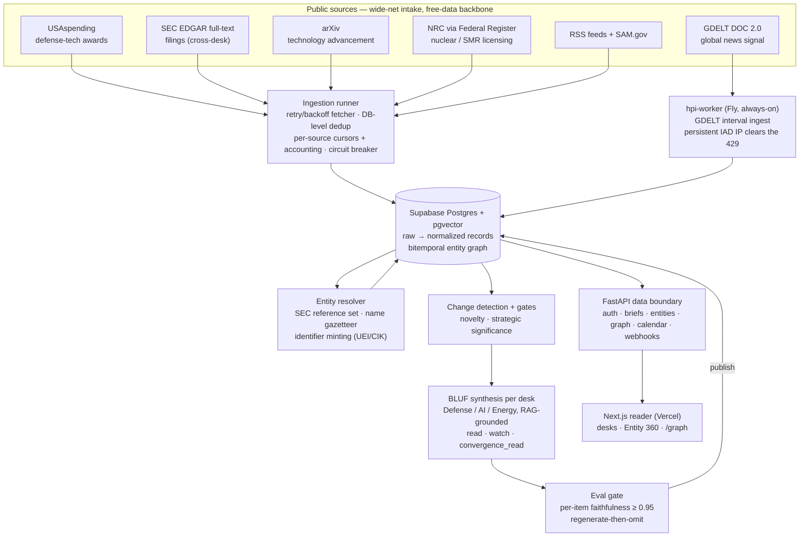

# Hard Power Intelligence — source-attributed market intelligence

**Live: https://hardpowerintel.com** (web reader; today's briefings are free to read, no
account needed) **API: https://hpi-api.fly.dev** — FastAPI on Fly.io, health at
[`/health`](https://hpi-api.fly.dev/health). Auth-gated data boundary per D011: the browser
never talks to Supabase data directly.

## What is this? (plain-language overview)

Hard Power Intelligence (HPI) answers one question every morning: *what changed yesterday
across defense, AI, and energy — and which companies does it actually touch?* It ingests
public primary records and news (federal contract awards, SEC filings, regulatory actions,
papers, global news signal), and writes each sector **desk** a briefing in **BLUF**
(Bottom Line Up Front) format — the structure intelligence products use: the conclusion
first, then the evidence, then the forward look.

You open the site, pick a desk (**Defense**, **AI**, **Energy**), and read a brief where
every item carries three things: the **cited fact** (with the URL it came from), a grounded
**read** (why it is material) and **watch** (forward catalyst), and a **confidence label**
that separates a confirmed primary record from reported news from HPI's own analysis.

The name is a triple play on *power* — **hard power** (defense), **electrical power**
(energy), and **compute power** (AI) — the three build-outs this product tracks, and
increasingly the three forces that overlap. Spotting those overlaps is the point (see
[Convergence](#approach-why-it-is-built-this-way)).

The thing that makes it more than a news summarizer:

- **Every item resolves to the investable entity behind it.** A contract award to
  *"Lockheed Martin Rotary and Mission Systems"* resolves to `LMT`, its segment, its
  program, and — via supply-chain edges — the second-order beneficiaries most tools miss.
  Public companies render as ticker chips; closely-held firms mint a "private" chip from
  authoritative identifiers (UEI/CIK), never a curated guess.
- **Provenance by construction.** Every ingested record carries a source URL, a fetch
  timestamp, and a content hash. Grounding is transparency the reader can check — not a
  filter that withholds important-but-not-airtight signal.
- **The eval gate can refuse to publish.** A per-item entailment evaluator checks every
  claim against its cited source before anything ships; a brief below the faithfulness
  threshold is regenerated, and failing items are excluded rather than softened.
  Hallucination — the industry's weakness — is turned into a visible trust signal.
- **The graph is the moat.** Companies that recur together across desks cluster in an
  interactive convergence map at [`/graph`](https://hardpowerintel.com/graph), and an
  entity spanning ≥2 desks is flagged as a cross-desk convergence signal.

HPI is a research and reporting tool, **not investment advice and not a stock-picker.**
It tells you what happened and why it might matter; what you do with that is up to you.

| | |
| --- | --- |
| Live site | https://hardpowerintel.com (Next.js on Vercel) — reader, Entity 360 pages, convergence graph |
| API | https://hpi-api.fly.dev — FastAPI on Fly.io (IAD), 7 route modules, JWT-gated data boundary (D011) |
| Desks | Defense · AI · Energy — one BLUF brief per desk per day, 06:00 UTC cadence |
| Sources | 7 adapters: USAspending, SEC EDGAR full-text, arXiv, NRC (Federal Register), GDELT, RSS feeds, SAM.gov |
| Entity graph | SEC-seeded reference set (~8k companies, de-duped by CIK); golden-set eval: precision 1.000 / recall 1.000, zero false links |
| Models | OpenRouter: DeepSeek V4 Flash (extraction), V4 Pro (synthesis), Qwen3.7 Max (eval); Fireworks cross-provider last resort; $3/run circuit breaker (D159) |
| Cost | ~$0.09 per brief; ~$80–230/mo infrastructure (Vercel + Fly + Supabase) |
| Tests | 751 backend, offline, ~6 s (`uv run pytest -m "not integration"`) + 82 web (`vitest run`) |
| Status | Deployed 2026-06-12; multi-desk on live data since 2026-06-14; checkout code built, Lemon Squeezy creds pending — everything is free today |

## Architecture at a glance



Where things live:

| Path | What it is |
| --- | --- |
| `engine/engine/adapters/` | 7 source adapters over one ingestion contract (`build_request_payload` / `parse` / `next_cursor`), registered in `registry.py` |
| `engine/engine/ingest/` | Fetcher (retry/backoff), runner (cursors, dedup, accounting, circuit breaker), hot-window retention |
| `engine/engine/entity/` | Reference set, gazetteer, resolver, graph builder, `CONVERGES_WITH` edges, federal-funding (`AWARDED`) edges, its own eval |
| `engine/engine/brief/` | Prompt, RAG retrieval, generator, analysis layer (read/watch), significance + epistemics grading, publish |
| `engine/engine/eval/` | Citation-faithfulness evaluator — per-item entailment against cited passages |
| `engine/engine/llm/` | OpenRouter/Litellm waterfall, two-phase last resort, per-run budget circuit breaker |
| `api/app/routers/` | `auth`, `briefs`, `entities`, `graph`, `calendar`, `webhooks` (Lemon Squeezy), `health` — the single data boundary |
| `worker/tasks/app.py` | The always-on GDELT worker: a plain asyncio interval loop, one Fly machine, no task queue |
| `web/` | Next.js 16 reader: desk pages, item drill-downs, Entity 360 (`/entity/[id]`), convergence graph (`/graph`) |
| `scripts/` | `run_ingest.py`, `run_brief.py`, eval harnesses (`eval_resolver.py`, `eval_significance.py`), health/cost reports |
| `.github/workflows/daily-brief.yml` | The 06:00 UTC cron: ingest once → publish all three desks concurrently (per-desk matrix, D113) |
| `docs/` | Philosophy, architecture, scope, data sources, plans (see [Documentation map](#documentation-map)) |

## Quickstart

Backend (Python 3.12+, [uv](https://docs.astral.sh/uv/)):

```bash
git clone https://github.com/PCSchmidt/HardPowerIntelligence
cd HardPowerIntelligence
uv sync --all-packages --extra dev
cp .env.example .env             # then fill in the keys below
uv run pytest -m "not integration"   # 751 tests, offline, no keys needed
```

`.env` needs `SUPABASE_URL`, `SUPABASE_SERVICE_ROLE_KEY`, `DATABASE_URL`, and
`OPENROUTER_API_KEY` for brief generation; `OPENAI_API_KEY` (embeddings) and
`SAM_GOV_API_KEY` for ingest. See [Operational notes](#data-and-keys).

API (FastAPI, http://localhost:8000/docs):

```bash
uv run uvicorn app.main:app --reload --app-dir api
```

Web reader (Next.js, http://localhost:3000):

```bash
cd web
npm install
npm run dev
```

Generate a brief locally against a populated database:

```bash
uv run python scripts/run_ingest.py                # fresh data from all active sources
uv run python scripts/run_brief.py --desk defense  # synthesize → eval → publish one desk
```

## Approach: why it is built this way

- **BLUF, because that is the product.** Summaries that start with background waste the
  reader's first ten seconds. Each item leads with the cited fact, then the grounded
  interpretation, then the forward catalyst — and the interpretation is visually separated
  as "Analysis — HPI interpretation" (P3) so fact and judgment never blur.
- **Adapters are narrow and boring on purpose.** Each source is a small class over a stable
  ingestion contract; a dead feed is a one-file change and shows up in the run accounting
  as a zero rather than as a silent gap in a brief. A per-source circuit breaker stops a
  repeatedly failing source from burning the whole window.
- **Store what is expensive, recompute what is cheap.** Ingested records are immutable and
  hashed; briefs are generated once per day and published. Adding a reader costs nothing —
  one shared brief per desk serves all subscribers, so the marginal cost of another reader
  is near zero.
- **The trust boundary is structural, not prompted.** The eval gate receives the brief and
  its cited passages and checks every claim with entailment; an uncited sentence fails
  automatically; a failing item is excluded, not softened. Publish requires a floor of
  provable claims (D070); a bad generation triggers a regenerate-then-omit (D072).
- **Resolution is precision-first.** A false entity link destroys trust faster than a
  missed link destroys usefulness, so the resolver is held to a golden-set accuracy eval
  gate and private companies are minted only from authoritative identifiers (UEI/CIK).
- **Wide-net intake, free-data backbone.** Public primary records (USAspending, EDGAR, NRC,
  SAM.gov) are the credible, free backbone — not the only admissible source. GDELT and
  arXiv widen the net; the moat is the entity graph and the judgment layered on it.
- **Cost is an engineering constraint, not an afterthought.** An enforced per-run circuit
  breaker ($3, D159) bounds a loop or glitch, a 402 credit-refill wait keeps routine blips
  on the cheaper primary (D158), and the cross-provider Fireworks reserve is reached only
  when OpenRouter is genuinely exhausted — proven end-to-end by forced-failure backstop
  tests.

## Motivation

The data that moves these sectors — DoD contract awards, EDGAR filings, NRC licensing,
hyperscaler capex, export-control actions — is public but fragmented, slow to read, and
disconnected from its market meaning. Serious investors don't lack data; they lack the
time to aggregate it and the tooling to connect a raw event to the security it affects.
HPI exists to do that aggregation, connection, and synthesis on a cadence — and to show
its work while doing it. See [docs/PHILOSOPHY.md](docs/PHILOSOPHY.md) for the full thesis.

## Method (what the pipeline actually does)

1. **Ingest.** `scripts/run_ingest.py` pulls every active source through a retry/backoff
   fetcher with DB-level dedup, per-source cursors + accounting, a circuit breaker, and
   hot-window retention (D057). Adapters emit immutable, hashed, cited records; new chunks
   are embedded. The 06:00 UTC GitHub Actions cron ingests once, then fans brief generation
   out over a per-desk matrix so the three desks generate concurrently (D113). GDELT runs
   separately on the always-on Fly worker (D116) — a shared-CI IP gets 429'd.
2. **Resolve entities.** The resolver links mentions to the investable entity: a SEC-seeded
   reference set (~8k companies, de-duped by CIK), a name gazetteer that lifts linking past
   the identifier-only ceiling, and identifier minting (UEI/CIK) for private firms (D091/D092).
   Cross-desk co-appearance writes `CONVERGES_WITH` edges; USAspending awards write
   `AWARDED` agency→company edges.
3. **Detect change and gate significance.** A novelty/anti-rehash gate down-ranks recently
   featured records so tomorrow is not a re-summary of today (D074). A
   strategic-significance gate drops true-but-trivial items, so a desk skips cleanly rather
   than publishing filler (D085).
4. **Synthesize.** One RAG-grounded BLUF generation per desk, temperature 0, over
   graph-resolved records (D062). Each item pairs the cited fact with a grounded `read` /
   `watch`, plus a brief-level `convergence_read` (D071/D073). Records touching ≥2 desks
   are boosted as the convergence signal (D060).
5. **Evaluate.** The citation evaluator scores every claim per item (D029): Qwen3.7 Max
   entailment against the cited passage, automatic failure for any uncited sentence,
   item-level exclusion on a failed item. Below-threshold desks regenerate; a provable-
   claim publish floor (D070) stops a technically-passing but empty brief.
6. **Publish and serve.** The brief lands in Supabase; the API serves it to the reader with
   entity chips, Entity 360 pages, and the convergence graph. Auth is JWT-gated at the API;
   the browser never touches the database directly (D011).

## Results

All numbers below are reproducible from this repo — see
[Verify the claims](#verify-the-claims-a-reviewers-path).

- **Entity resolution (the moat, gated):** golden-set eval — precision **1.000**, recall
  **1.000**, **zero false links** (re-verified 2026-09-15: 9/9 resolvable mentions
  resolved correctly; the golden set is small, which is why the gate runs on every change).
  Verified end-to-end on a live brief with every link correct (`scripts/eval_resolver.py`).
- **Citation faithfulness (publish gate):** threshold **0.95**; every recorded baseline run
  published at **1.000** — 2026-06-06 (first integration), 2026-06-12 (first production),
  2026-06-14 (first live-data brief, 8/8 claims), 2026-06-16 (first layered brief; one
  unsupported item excluded by the gate, the rest survived at 1.00). Full log in
  [EVAL_BASELINE.md](EVAL_BASELINE.md).
- **Tests:** **751 backend tests pass offline in ~5.5 s** with no credentials
  (`uv run pytest -m "not integration"`; engine line coverage 89%) and **82 web tests
  pass** (`cd web && npx vitest run`, 14 files).
- **Production verified 2026-09-15:** https://hardpowerintel.com returns `200` and renders
  the Defense desk and `/graph`; the API health endpoint reports `status: ok`, `version:
  1.0.0`. Brief endpoints are auth-gated as designed (D011).
- **Cost:** ~$0.09 per brief; infrastructure ~$80–230/mo. Break-even is designed at a small
  number of subscribers.

## Limitations

- **No checkout yet.** The Lemon Squeezy subscription code is built (checkout, portal,
  webhooks), but account credentials and variant IDs are not configured — so everything on
  the site is free today. This is config, not engineering
  ([docs/PAYMENTS_GOLIVE_PLAN.md](docs/PAYMENTS_GOLIVE_PLAN.md)).
- **Desk depth is uneven.** Defense is the deepest desk (USAspending + EDGAR + GDELT). AI
  and Energy lean on cross-desk sources (EDGAR, arXiv) plus NRC for Energy; dedicated
  sources (EIA, interconnection queues, more AI-infra) are the next depth work, and the
  AI/Energy desks still owe a live-validation pass.
- **The eval baseline is small.** Four recorded runs, all early; the score-distribution and
  failure-mode tables in [EVAL_BASELINE.md](EVAL_BASELINE.md) are not yet populated with
  enough briefs to show drift. The gate is real; its track record is short.
- **One cadence, GitHub-scheduled.** Briefs generate once daily at 06:00 UTC via Actions,
  and GitHub delays scheduled runs by 40–100+ minutes under load — the early cron buys
  buffer, but there is no on-demand regeneration in production.
- **The flagship convergence brief is not shipped.** The per-desk briefs and the
  cross-desk graph are live; the dedicated cross-domain convergence brief is the remaining
  product milestone.
- **The GDELT worker is a single machine.** `fly scale count 1` is load-bearing: a second
  machine would double-ingest. Correct but fragile until a lease/dedup exists.
- **Coverage gaps exist.** 89% engine line coverage is good, not complete; the uncovered
  tail is mostly error paths and ops plumbing.

## Operational notes

### Deploy targets

| Target | What runs | How it deploys |
| --- | --- | --- |
| Vercel | Next.js reader (`web/`) | push to `main` |
| Fly.io — `hpi-api` | FastAPI data boundary, `docker/Dockerfile.api`, `fly.api.toml` | `fly deploy --config fly.api.toml` |
| Fly.io — `hpi-worker` | Always-on GDELT ingest, `docker/Dockerfile.worker`, `fly.worker.toml` — scale count must stay **1** | `fly deploy --config fly.worker.toml` |
| GitHub Actions — `daily-brief.yml` | 06:00 UTC: ingest once → three desk briefs concurrently | scheduled; manual `workflow_dispatch` for one desk |
| GitHub Actions — `meridian.yml` | Meridian gate CI: `./run-tests.sh` (pytest + `next build`) | every push |

### Data and keys

| Variable | Purpose |
| --- | --- |
| `SUPABASE_URL`, `SUPABASE_SERVICE_ROLE_KEY` | database access (service role; never browser-exposed) |
| `DATABASE_URL` | direct asyncpg connection for engine/worker ingest |
| `NEXT_PUBLIC_SUPABASE_URL`, `NEXT_PUBLIC_SUPABASE_ANON_KEY` | web auth (publishable) |
| `OPENROUTER_API_KEY` | all non-Anthropic LLM roles (extraction, synthesis, eval) |
| `OPENAI_API_KEY` | embeddings for ingested records |
| `SAM_GOV_API_KEY` | SAM.gov contract-opportunity adapter |
| `FIREWORKS_API_KEY` | cross-provider LLM last resort (D155), reached only after OpenRouter is exhausted |
| `LLM_RUN_BUDGET_USD` | enforced per-run circuit breaker, default $3 (D159) |
| `LEMONSQUEEZY_API_KEY` / `_STORE_ID` / `_WEBHOOK_SECRET` | subscriptions — set when checkout goes live |

Model role assignments are env-swappable without code changes (D006):
`LLM_MODEL_EXTRACTION` / `LLM_MODEL_DISAMBIGUATION` (DeepSeek V4 Flash),
`LLM_MODEL_SYNTHESIS` (DeepSeek V4 Pro), `LLM_MODEL_EVAL` +
`LLM_MODEL_SYNTHESIS_FALLBACK` (Qwen3.7 Max). Never in the repo, never in a log.

### Verify the claims (a reviewer's path)

```bash
# backend suite, offline — 751 passed in ~6 s
uv run pytest -m "not integration" -q

# web suite — 82 passed
cd web && npx vitest run

# entity-resolution accuracy on the golden set
uv run python scripts/eval_resolver.py

# is production healthy, and which version is live?
curl https://hpi-api.fly.dev/health

# is the site serving the reader and the graph?
curl -s -o /dev/null -w "%{http_code}" https://hardpowerintel.com/desk/defense
curl -s -o /dev/null -w "%{http_code}" https://hardpowerintel.com/graph
```

Then open https://hardpowerintel.com, read the Defense desk, click an entity chip through
to its Entity 360 page, and open `/graph` — hover a gold convergence node and its edges to
see the cited stories behind each connection.

### Documentation map

| Doc | What it covers |
| --- | --- |
| [docs/PHILOSOPHY.md](docs/PHILOSOPHY.md) | why HPI exists: the thesis, the moat, design principles, regulatory posture |
| [docs/ARCHITECTURE.md](docs/ARCHITECTURE.md) | system design: pipeline, entity graph, scheduler, adapters, brief generation |
| [docs/SCOPE.md](docs/SCOPE.md) | in/out of scope, build cycles, the three desks, success criteria |
| [docs/DATA_SOURCES.md](docs/DATA_SOURCES.md) | source categories, free-vs-paid tiers, licensing posture |
| [docs/PERSONAS.md](docs/PERSONAS.md) / [docs/PHASE_PLAN.md](docs/PHASE_PLAN.md) | who it is for; how the build is phased |
| [docs/CONVERGENCE_GRAPH_PLAN.md](docs/CONVERGENCE_GRAPH_PLAN.md) | the `/graph` design (D146–D153) |
| [docs/PAYMENTS_GOLIVE_PLAN.md](docs/PAYMENTS_GOLIVE_PLAN.md) | the remaining checkout go-live steps |
| [SPEC.md](SPEC.md) / [CONTRACT.md](CONTRACT.md) / [API_SPEC.md](API_SPEC.md) | product spec, data contracts, API surface |
| [DATABASE_SCHEMA.md](DATABASE_SCHEMA.md) | Supabase schema |
| [EVAL_BASELINE.md](EVAL_BASELINE.md) | the citation-faithfulness eval gate: config, run log, thresholds |
| [DECISIONS.md](DECISIONS.md) | dated architecture decisions (D001–D159+) |
| [DEPLOYMENT_CONFIG.md](DEPLOYMENT_CONFIG.md) / [DEPLOY_RUNBOOK.md](DEPLOY_RUNBOOK.md) | production topology, variables, runbooks |
| [DESIGN_SYSTEM.md](DESIGN_SYSTEM.md) / [COMPONENT_REGISTRY.md](COMPONENT_REGISTRY.md) | visual language and UI inventory |
| [CHANGELOG.md](CHANGELOG.md) | notable changes per deploy |
| [SECURITY_AUDIT.md](SECURITY_AUDIT.md) | security review state |

## Engineering governance

This repository is built under **[Meridian](https://github.com/PCSchmidt/meridian)**, an
agent-harness framework that enforces a gate-by-gate workflow (build → test → docs →
reflexion → commit, one gate at a time) with schema-validated memory and independent
evaluation. HPI also serves as a Meridian dogfooding exercise: its hybrid nature — a
full-stack web app whose core is an ML/RAG eval pipeline — exercises Meridian's composable
gate DAG. Gates 1–8 are closed; build progress is tracked in `.meridian/gates.yaml`, scope
boundaries in [docs/SCOPE.md](docs/SCOPE.md).

## Disclaimer

Hard Power Intelligence produces **informational research, not investment advice**.
Nothing it generates is a recommendation to buy or sell any security. Always do your own
research.

## License

Source-available under the [PolyForm Noncommercial License 1.0.0](LICENSE). You are
welcome to read, study, fork, and build on this code for any **noncommercial** purpose.
**Commercial use requires a separate license** from the author — please get in touch. This
is not an OSI "open source" license; commercial rights are reserved.

## Author

**Paul Christopher Schmidt** — [@PCSchmidt](https://github.com/PCSchmidt)
